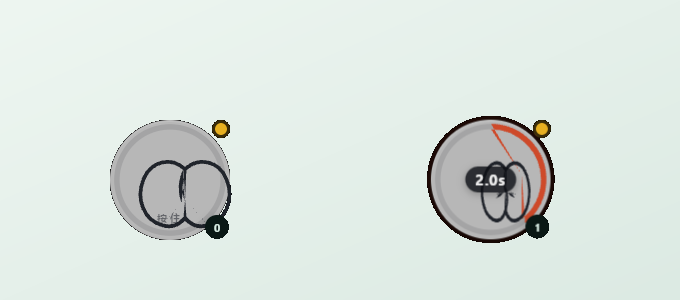
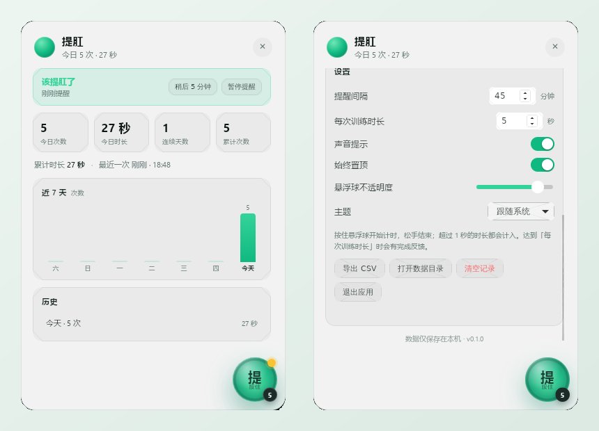

# 提肛 · TiGang

一个常驻桌面的提肛（凯格尔）提醒浮窗。按住「小蜜桃」即开始计时——按住多久，就等于你收缩保持多久；蜜桃随之横向压缩「被夹住」、切换成夹紧线稿并抖动，松开回弹并记录本次训练。按设定的间隔（默认 45 分钟）提醒你起身练一组，并统计次数、总时长与每日历史。

纯本地单机应用：不联网、无账号、数据只存在你自己的电脑上。支持 **Windows / macOS / Linux**。

<p align="center">
  
</p>

<p align="center">
  
</p>

## 下载

- **Linux**：到 [Releases](https://github.com/96980754/ass_we_can/releases) 下载 `.deb` / `.rpm` / `.AppImage`。
- **Windows / macOS**：在仓库 Actions 中手动触发 `release` 工作流（矩阵构建），或在本机执行 `pnpm tauri build`。

```bash
# Debian / Ubuntu
sudo dpkg -i TiGang_0.1.1_amd64.deb

# 任意发行版（免安装）
chmod +x TiGang_0.1.1_amd64.AppImage && ./TiGang_0.1.1_amd64.AppImage
```

## 功能

- **按住计时**：按住小蜜桃，蜜桃横向压缩「被夹住」并抖动、环形进度显示已保持秒数；松开回弹并记录。
- **有效判定**：超过 1 秒即计入；少于等于 1 秒会抖动提示「太短了」，不记录。
- **目标时长**：可在设置里设定每次训练时长（默认 5 秒），进度环达标变绿并给出提示音。
- **每组次数**：可设定每组训练次数（默认 10 次）；长按时球上显示「还差 N 次」，完成整组后才会清除本次提醒。
- **放松倒计时**：松手后进入 3 秒放松倒计时（系统控制），再次按住可立即打断并开始下一次。
- **边缘吸附**：把蜜桃拖到屏幕边缘或四角附近，松手后会自动吸附对齐。
- **定时提醒**：间隔可自定义（默认 45 分钟）；到点系统通知 + 球体脉冲发光；支持「稍后 5 分钟」与暂停。
- **统计**：今日次数/时长、连续天数、累计次数/时长、近 7 天柱状图、按天历史明细。
- **托盘常驻**：左键托盘打开面板，右键菜单可立即提醒、暂停、隐藏悬浮球、退出。
- **面板内退出**：设置区提供「退出应用」，在没有系统托盘的环境（如 WSLg）也能正常退出。
- **导出**：一键导出 CSV（含 BOM，Excel 可直接打开）。

## 使用

1. 启动后屏幕右侧出现一个小蜜桃（屁股简笔画）悬浮球。
2. **按住**蜜桃开始一次提肛训练：蜜桃被横向「夹住」、抖动，环形进度走近；达到目标秒数时进度环高亮。
3. **松手**结束，本次时长计入统计，蜜桃恢复放松并进入 3 秒放松倒计时；倒计时中再次按住可打断。
4. 按设定次数完成一组后会有完成反馈；**轻点**蜜桃展开面板，查看统计、历史与设置。
5. 按住并移动可拖动悬浮球到任意位置，位置会记住。

## 排行榜（规划）

全球排行榜的服务端契约、反作弊与客户端接入方案见
[docs/leaderboard-design.md](docs/leaderboard-design.md)。当前版本保持完全离线，未接入任何网络请求。

## 数据位置

| 系统 | 路径 |
| --- | --- |
| Windows | `%APPDATA%\com.hmy.tigang` |
| macOS | `~/Library/Application Support/com.hmy.tigang` |
| Linux | `~/.local/share/com.hmy.tigang` |

- `settings.json`：设置与提醒状态（原子写入，保留 `.bak` 备份）
- `reps.jsonl`：每行一条训练记录（追加写入）

面板里的「打开数据目录」可直接跳转。

## 开发

前置：Node 22+、pnpm、Rust stable。

```bash
pnpm install
pnpm tauri dev      # 开发模式
pnpm tauri build    # 打包当前平台产物
```

### Linux 依赖（Ubuntu / Debian）

```bash
sudo apt update
sudo apt install -y libwebkit2gtk-4.1-dev build-essential curl wget file \
  libxdo-dev libssl-dev libayatana-appindicator3-dev librsvg2-dev
```

Ubuntu 22.04 的 `jammy-updates` 已提供 `libwebkit2gtk-4.1-dev`，无需额外 PPA。

### 开发自测脚本

| 脚本 | 用途 |
| --- | --- |
| `scripts/gen-icon.py` | 用纯标准库生成 1024×1024 应用图标 |
| `scripts/xinput.py` | 通过 XTEST 模拟鼠标移动/长按/单击，用于自动化验证 |
| `scripts/xshot.c` | 抓取指定 X11 窗口像素为 PPM，便于截图检查 UI |

```bash
# 模拟在 (1000, 500) 处长按 5 秒
python3 scripts/xinput.py hold 1000 500 5000

# 单元测试
pnpm test:rust
```

### 打包

- Windows：`nsis` / `msi`（需在 Windows 上构建）
- macOS：`app` / `dmg`（需在 macOS 上构建；未签名版本首次打开需右键 → 打开）
- Linux：`deb` / `appimage`

三平台产物通过 GitHub Actions 矩阵构建：在仓库 Actions 里手动运行 `release` 工作流即可，构建完成后会把对应平台安装包附加到同版本 Release。

## 已知限制

- **Wayland**：原生 Wayland 不允许应用自行定位/置顶窗口，程序在 Linux 上会自动设置 `GDK_BACKEND=x11` 走 XWayland。若你的环境没有 XWayland，悬浮球可能无法置顶或拖动。
- **WSLg**：仅用于开发预览。WSLg 下系统托盘没有宿主、系统通知没有守护进程，且窗口边框/缩放由 Weston 接管，可能出现几像素的位置偏差；原生 Linux 桌面不受影响。
- **macOS 未签名**：首次打开需右键选择「打开」；正式分发需配置开发者证书与公证。
- **通知权限**：系统通知被拒绝时，提醒会降级为球体脉冲 + 应用内提示。
- **「震动」为视觉效果**：桌面端没有硬件震动马达，采用球体抖动动画 + 合成提示音。

## 许可证

[MIT](LICENSE) © 2026 hmy
